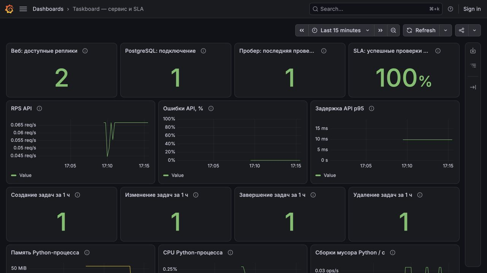
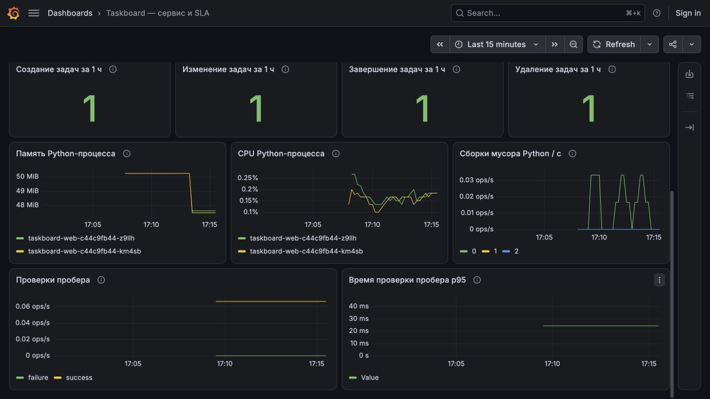
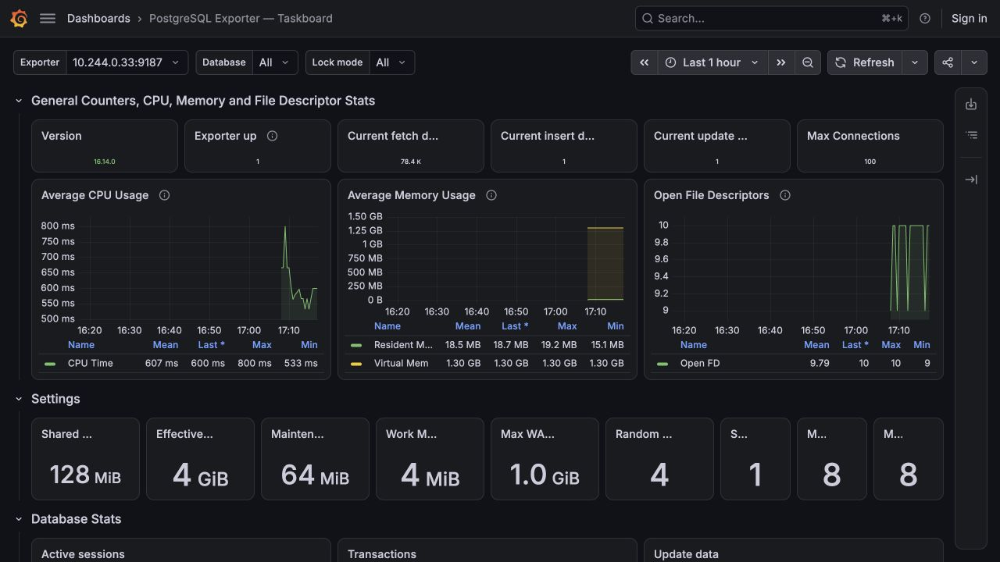
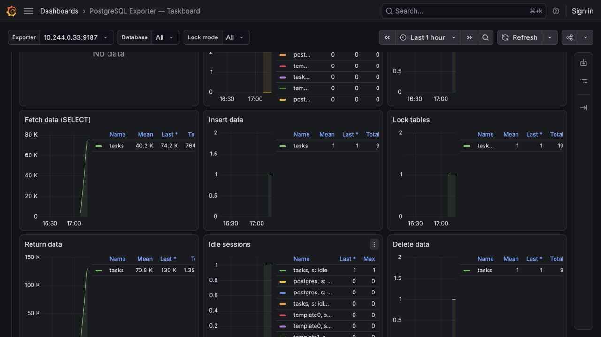

# Отчёт: дашборды Grafana

## Стек и источники

Приложение «Список задач» работает на Flask/Gunicorn и PostgreSQL в Minikube. Метрики собирает VictoriaMetrics Single. Grafana 13.3.1 установлена Helm-чартом `grafana-community/grafana` 14.4.1 в namespace `monitoring`, её данные хранятся на PVC. Источник `VictoriaMetrics` настроен автоматически как Prometheus-совместимый endpoint `http://vm-single-victoria-metrics-single-server.monitoring.svc.cluster.local:8428`.

## Панели приложения



| Панели | Метрики и причина выбора |
| --- | --- |
| Доступные веб-реплики, PostgreSQL и последняя проверка пробера | `up`, `pg_up`, `taskboard_probe_success` сразу показывают состояние основных компонентов. |
| RPS API, доля ошибок 5xx, задержка p95 | `flask_http_request_duration_seconds_count` и `flask_http_request_duration_seconds_bucket` дают RED: частоту запросов, ошибки и длительность. Фильтр `url_rule=~"/api/tasks.*"` исключает служебные проверки. |
| Создание, изменение, завершение и удаление задач за час | `increase(taskboard_tasks_*_total[1h])` показывает реальные пользовательские операции; счётчики суммируются по репликам и корректно обрабатывают перезапуск Pod. |
| Память, CPU и сборка мусора Python | `process_resident_memory_bytes`, `process_cpu_seconds_total`, `python_gc_collections_total` помогают заметить нехватку ресурсов и проблемы рантайма. |
| Частота и длительность проверок пробера | `taskboard_probe_checks_total` и `taskboard_probe_duration_seconds_bucket` помогают отличить отказ приложения от проблем самого пробера. |



## SLA пробера

Отдельный Pod `taskboard-probe` каждые 15 секунд проверяет `/readyz` (в том числе доступность БД) и `GET /api/tasks`, затем экспортирует результат на порту 9115. VictoriaMetrics обнаруживает Pod по аннотациям `prometheus.io/*`.

Панель **«SLA: успешные проверки за 24 ч»** вычисляет:

```promql
100 * sum(increase(taskboard_probe_checks_total{app="taskboard-probe",result="success"}[24h]))
  / clamp_min(sum(increase(taskboard_probe_checks_total{app="taskboard-probe"}[24h])), 1)
```

Целевое значение SLO — 99,9%; ниже него панель становится красной. Панель показывает наблюдаемую доступность за скользящие 24 часа, а не гарантированный договором SLA. Пока пробер работает меньше 24 часов, расчёт основан на имеющихся проверках. При отсутствии достаточных данных значение не подменяется искусственными 100%.

## PostgreSQL Exporter





Импортирован дашборд [PostgreSQL Database 9628, revision 8](https://grafana.com/grafana/dashboards/9628-postgresql-database/). Его JSON адаптирован к меткам нашего `postgres_exporter`: удалён отсутствующий фильтр `release`, используется переменная `instance`, источник заменён на `VictoriaMetrics`. Устаревшая панель времени запуска заменена на `pg_up`, исправлены единицы счётчика выборок и запрос памяти процесса. На скриншоте видны версия PostgreSQL, лимит подключений, настройки памяти и графики экспортёра.

## Проверка

В Minikube работают Grafana, VictoriaMetrics, приложение, PostgreSQL и пробер. Проверены все 16 PromQL-запросов дашборда приложения: они возвращают реальные временные ряды. Для проверки бизнес-панелей была создана, завершена и удалена одна временная задача; все четыре счётчика показали 1. Оба дашборда доступны в интерфейсе Grafana, а короткая запись экрана находится в `Демонстрация.mp4`.
